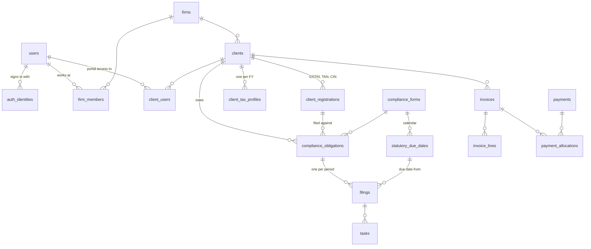

# Data model

> **Status:** approved as the starting schema, 20 Nov 2026. First migration:
> [drizzle/0000_initial_schema.sql](../drizzle/0000_initial_schema.sql). Source:
> [src/db/schema/](../src/db/schema/).

This is the Postgres schema for the practice management app: 52 tables across ten modules. It covers
everything the workstation UI shows today except Books (see [What's left out](#whats-left-out)), plus
login for both firm staff and clients. We'll change it through new migrations as the product firms up.

The last section lists open questions. Some are domain questions for the CA side; the rest are
engineering calls. Answers may mean follow-up migrations.

## Ground rules

**Plain Postgres, no vendor features.** No Supabase Auth, no `auth.uid()`, no extensions. It needs
Postgres 15 or newer (for `UNIQUE NULLS NOT DISTINCT`) and runs on Supabase, RDS, Neon, Cloud SQL or
a VM without changes. Moving means changing `DATABASE_URL` and, if the new host uses a different CA,
`DATABASE_CA_CERT`.

**Every firm-owned row carries `firm_id`, and references between them include it.** A task's client is
stored as `(firm_id, client_id)` and the foreign key points at `clients (firm_id, id)`. If a bug ever
tries to attach firm B's task to firm A's client, Postgres rejects the write. Application code still
filters every query by firm; the composite keys are the backstop. Deleting a firm cascades through all
its data, which is how a tenant gets purged.

**Row-level security is on for every table, with no policies yet.** That locks out every role except
the table owner and roles with `BYPASSRLS`, which is what our app connects as. It matters on Supabase in
particular: its default privileges give the public `anon` role read and write on new tables in
`public`, reachable through the auto-generated REST API with a key that ships to browsers. With RLS on
and no policy, that role sees nothing. `ENABLE ROW LEVEL SECURITY` is plain Postgres, so this costs no
portability.

**JSONB where shapes vary or grow; typed columns for anything we filter, sort, join or constrain.**
That's the line between flexible and unqueryable. A filing's status and due date drive the Due Board, so
they're columns with indexes and checks. The GSTR-3B figures captured on that filing differ from form to
form, so they go in `filings.data`. In practice that means:

- `metadata` (default `{}`) on every main table, for data we haven't modelled yet
- `custom_fields` on clients, contacts, members, engagements, filings, notices, tasks and documents,
  with definitions in `custom_field_definitions` so a firm can add its own fields without a migration
- type-specific JSONB where the shape depends on a type: `client_registrations.attributes` (GST scheme
  history, taxpayer type, ROC code), `compliance_forms.applicability` and `.fields`,
  `automation_rules.conditions` and `.actions`, `documents.extracted` (OCR output)
- lists that belong to one row and are never queried on their own: task checklists, document request
  items, hearing dates on a notice, due-date extension history

TypeScript shapes for these live in [json.ts](../src/db/schema/json.ts). The database won't validate
them, so we validate at the write boundary.

**Statuses are `text` with a CHECK constraint, not Postgres enums.** Adding a value means editing one
array in [enums.ts](../src/db/schema/enums.ts) and generating a migration that swaps the constraint.
Postgres enums can't drop a value at all. Stored values are slugs (`ready_to_file`); the UI owns the
labels.

**Don't store what can be worked out.** The UI shows reminders sent, last contacted, hours logged, staff
load, invoice paid or overdue, and Due Board batches. None of these is a column; each comes from
`messages`, `time_entries`, `tasks`, `payment_allocations` or `filings`. Counters drift, and a query
can't. If one of these gets slow, we add a cached column with a trigger and keep the source of truth.

The one deliberate exception is issued invoices. An invoice is a legal document, so the supplier and
recipient details and every total are frozen on the row at issue and never recomputed.

**Statutory records have statuses, not deletes.** Filings, invoices and payments have no `deleted_at`. A
filing that isn't due becomes `not_applicable`; a wrong invoice gets cancelled or reversed with a credit
note. Things people might want back (clients, documents, tasks, contacts) are soft-deleted, and unique
rules such as "one client code per firm" ignore deleted rows.

**Other conventions.** IDs are UUIDv7, generated in the app, so they sort by creation time and keep
index inserts cheap. Money is `numeric(15,2)`, read as a string so a rupee amount never passes through a
float. Calendar dates (due dates, filing dates) are `date`; instants are `timestamptz`. Financial years
are stored as `'2026-27'`. Columns are snake_case in SQL and camelCase in TypeScript.

## Login: staff and clients

Everyone who signs in is a row in `users`: partners, articles, and a client's accountant checking the
portal. What they can reach depends on two membership tables:

| Table          | Means                                                     | One user can have          |
| -------------- | --------------------------------------------------------- | -------------------------- |
| `firm_members` | works at this firm, with a role and permissions           | several firms              |
| `client_users` | can see this client in the portal, as owner/member/viewer | several clients (a family) |

How someone signs in is separate again. `auth_identities` holds one row per sign-in method, with
`provider` as an open string. Email and password is `provider = 'password'` with an argon2id hash.
Adding Google later means writing a row with `provider = 'google'` and Google's subject ID: no schema
change. Microsoft, Apple, any OIDC provider and SAML for larger firms all fit the same way. A user can
link several methods, and an email the provider asserts is never trusted on its own to link accounts.

Sessions live in our database (`auth_sessions`). The cookie carries a random token and we store only its
SHA-256 hash, so a database leak doesn't hand out live sessions and logging someone out everywhere is one
`UPDATE`. `auth_tokens` covers email verification, password reset, magic links and OTPs (phone OTP is
there for clients who'd rather not use email). `mfa_factors` holds TOTP and passkeys. `auth_events` is
the security log, and also what rate limiting and lockout read from.

`users` needs at least one of email, phone or username, so a client can have a phone-only login.

## Modules

| Module            | Tables                                                                                                                                                             |
| ----------------- | ------------------------------------------------------------------------------------------------------------------------------------------------------------------ |
| Identity and auth | `users`, `auth_identities`, `auth_sessions`, `auth_tokens`, `mfa_factors`, `auth_events`                                                                           |
| Firm              | `firms`, `firm_branches`, `roles`, `firm_members`, `teams`, `team_members`, `invitations`                                                                          |
| Clients           | `clients`, `client_groups`, `client_tax_profiles`, `contacts`, `client_contacts`, `client_registrations`, `client_users`, `client_credentials`, `dsc_certificates` |
| Services          | `services`, `engagements`                                                                                                                                          |
| Compliance        | `compliance_forms`, `statutory_due_dates`, `compliance_obligations`, `filings`, `notices`                                                                          |
| Work              | `tasks`, `task_templates`, `recurring_tasks`, `time_entries`, `comments`                                                                                           |
| Documents         | `documents`, `document_folders`, `document_links`, `document_requests`                                                                                             |
| Billing           | `invoices`, `invoice_lines`, `payments`, `payment_allocations`, `disbursements`                                                                                    |
| Communication     | `messages`, `message_templates`, `automation_rules`, `notifications`                                                                                               |
| Platform          | `activity_log`, `custom_field_definitions`, `saved_views`, `firm_integrations`, `number_sequences`                                                                 |

The core of it, from login to a filed return and its invoice:

### Clients

A client is one legal person, which means one PAN; a firm can't hold the same PAN twice. Families and
business groups (the promoter, the HUF, three companies) are linked through `client_groups`.

GSTINs, TAN, CIN, LLPIN, EPFO, ESIC, PT and the rest are rows in `client_registrations`, because a client
with branches in three states has three GSTINs and each one files its own returns. Checks enforce the
GSTIN, TAN, CIN and LLPIN formats, and that a GSTIN's first two digits match its state code.

`client_tax_profiles` holds the facts that change each year and decide what's due: residential status,
old or new regime, tax audit under 44AB, transfer pricing under 92E, presumptive scheme, turnover.

People are firm-wide `contacts` linked to clients through `client_contacts`, because one director often
sits on several client companies and DIR-3 KYC is filed once per DIN, not once per company.

`client_credentials` is the vault for Income Tax, GST, TRACES and MCA logins. Secrets are encrypted in
the app with a key held outside the database, and every reveal goes to `activity_log`.
`dsc_certificates` is the DSC register: holder, expiry, and who has the token.

### Compliance

This is the part that has to be right.

1. **`compliance_forms`** is the catalogue: GSTR-1, GSTR-3B, CMP-08, 24Q, 26Q, ITR-1 to 7, AOC-4,
   MGT-7, DIR-3 KYC and so on. We maintain the built-in rows (no `firm_id`); a firm can add its own.
   Each form says what it's filed against (the PAN or a registration type) and carries a declarative
   applicability rule.
2. **`statutory_due_dates`** is the calendar, one row per form, period and variant. Variants handle dates
   that differ within one form: QRMP GSTR-3B for category X states versus Y, or ITR for non-audit, audit
   and transfer-pricing cases.
3. **`compliance_obligations`** says "this client files GSTR-3B on this GSTIN". The generator creates
   these from the applicability rules and the client's registrations and tax profile; staff can add
   or pause them by hand.
4. **`filings`** is one obligation for one period, the unit of work on the Due Board. It stores the
   effective due date so lists can sort on it, plus a link to the calendar row it came from.

When CBIC or CBDT extends a date, we change the calendar row once and push it to every open filing that
uses it in one `UPDATE`, skipping filings where someone set the date by hand. The extension history stays
on the calendar row.

A revised return or a TDS correction statement is a new filing with `revision` + 1 that points at the
original. The database allows only one filing per client, registration, form, period and revision.

`notices` tracks notices and demands: section, reference number, response deadline, demand amount,
hearings and outcome.

### Billing

The firm's own invoices to its clients. Invoice numbers are assigned on issue, not on draft, so a deleted
draft doesn't leave a gap in the series; `number_sequences` hands out numbers per firm and FY without
two requests getting the same one.

Clients usually deduct TDS under 194J before paying, so a payment records the amount that reached the bank
and the TDS separately, and allocations against invoices settle the gross. Reimbursements paid as the
client's pure agent (ROC fees, for instance) are flagged on the invoice line and carry no GST.

### The rest

`tasks` link to a filing, a notice or an engagement, or stand alone, and checklists come from
`task_templates`. `time_entries` copy the billing and cost rates at the time of entry, so a rate change
later doesn't rewrite history.

`documents` keeps the storage key, checksum and classification; the file itself lives in any
S3-compatible store. One document can link to many records through `document_links`. When a filing sits
at "awaiting data", `document_requests` tracks what we're waiting on, item by item.

`messages` logs every WhatsApp, email and SMS in or out, which is where reminder counts and "last
contacted" come from. Provider names are plain text, so switching WhatsApp vendors is configuration.

`activity_log` is the append-only audit trail: field-level diffs, who, when, from which IP. The app's
database role should get INSERT and SELECT on it and nothing else.

## Verified so far

The schema typechecks and lints. The first migration is 373 SQL statements, all creates (52 tables with
RLS enabled, 183 foreign keys, 86 indexes, 105 check constraints, longest identifier 55 characters). It
was applied to an in-memory Postgres 18 (PGlite), followed by 22 checks: valid rows went in, and each of
these was rejected:

- a filing in one firm pointing at another firm's client, or assigned to another firm's staff member
- a GSTIN whose state digits don't match its state code; a malformed PAN; the same PAN twice in a firm
- a second filing for the same form and period, including PAN-level forms with no registration
- `filed` status without a filing date, or a status value that doesn't exist
- an issued invoice without a number, or a credit note without the original invoice

Deleting a firm removed its clients, filings and invoices and left the other firm untouched.

The target database (Supabase, Postgres 17.12) had an empty `public` schema before the first migration,
so the migration creates everything and replaces nothing.

## What's left out

**Books.** The client accounting module (ledgers, vouchers, bank reconciliation, trial balance) is still an
open decision in [PRODUCT.md](PRODUCT.md). Many clients keep books in Tally, and importing from it may
matter more than a ledger of our own. A double-entry schema done halfway is worse than none, so it waits
for that decision.

The Cockpit's exception list doesn't get a table either. DSC expiry, overdue fees, notices, late fees and
pending documents are all queries over the tables above.

Also out for now: filing returns through a GSP, a job queue for reminders (we'll pick a Postgres-backed
one when automations ship), full-text search, and API keys and webhooks for the platform phase.

## Open questions

For the CA side:

1. **One client per PAN.** A proprietorship uses the proprietor's PAN, so as designed, "Rajesh Shah" and
   "Shah Traders" are one client, with the trade name on the GSTIN. That's legally right, but do firms
   expect to see them as two rows? If so, we drop the one-PAN-per-firm rule and link the two.
2. **Applicability inputs.** Are residential status, tax regime, 44AB audit, 92E transfer pricing,
   presumptive scheme, turnover and employer status enough to decide every form we'll ship first? What's
   missing?
3. **Filing steps.** The statuses are not started, awaiting data, in preparation, in review, ready to
   file, filed. An ITR isn't complete until the taxpayer e-verifies it. Does that need its own status
   ("filed, pending verification"), or is a verification date on the filing enough?
4. **Credential vault.** Firms keep client portal passwords today, often in a spreadsheet. Are we
   comfortable holding them (encrypted, with every reveal logged) from launch, or should the vault wait?
5. **Retention.** How long must the firm keep each kind of document? This sets `documents.retain_until`.
6. **TDS on fees.** Is recording net receipt plus TDS, with the gross settling the invoice, how firms
   reconcile against their own 26AS?

For engineering:

7. **Firm-scoped RLS policies.** RLS is already on, which shuts out exposed API roles. The next step is
   policies on `current_setting('app.firm_id')`, so even our own app can't read across firms by mistake.
   That needs the app to connect as its own non-owner role without `BYPASSRLS`. Recommendation: do it
   before real client data goes in.
8. **Auth implementation.** The tables fit either building it ourselves (argon2id, our session table, a
   small OAuth client such as Arctic when Google arrives) or a library like Better Auth mapped onto these
   tables. Recommendation: build it ourselves; email and password plus sessions is a few hundred lines,
   all server-side, and we keep full control of the client portal flows.
9. **Document storage.** Any S3-compatible bucket works with this schema. We should pick one in an Indian
   region alongside the database.

## Next steps

1. Run the first migration against the development database (`npm run db:migrate`).
2. Seed the compliance catalogue and the FY 2026-27 calendar, with the CA reviewing every row.
3. Add the database client and a firm-scoped query layer, then switch
   [src/data/queries.ts](../src/data/queries.ts) from mock data to Postgres one screen at a time, starting
   with Clients and Compliance. The UI keeps its own types in `src/domain/types.ts`; queries map rows to
   them.
4. Build email and password sign-in.
